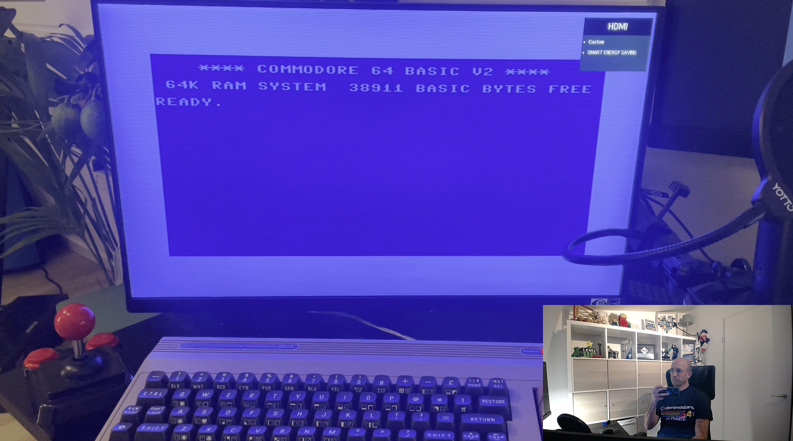
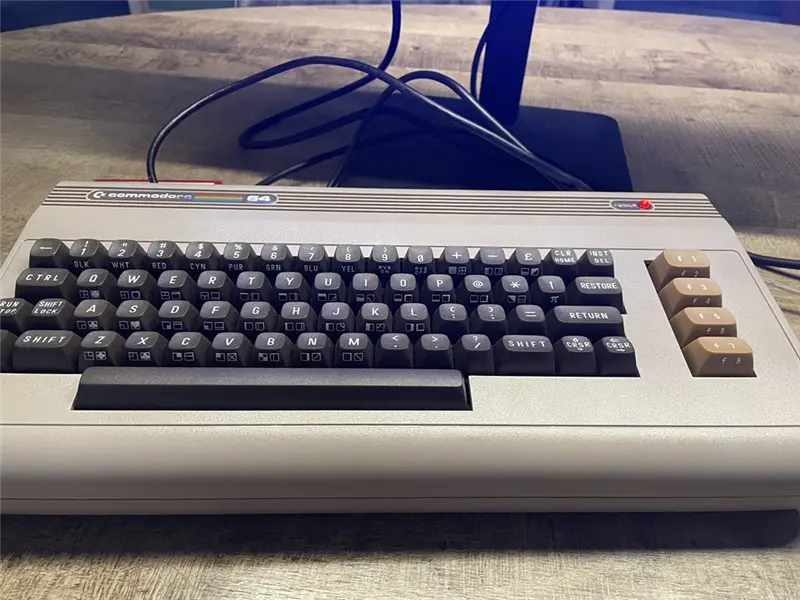
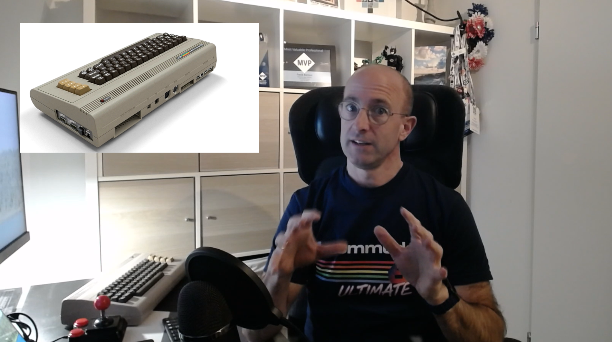

# Controlling the State of the C64 with Bicep 🖥️➡️🕹️

> **What if you could manage a Commodore 64 the same way you manage Azure resources?**
>
> This project uses **Bicep local deploy** and a **custom Bicep extension** to declare the *desired state* of a real, physical Commodore 64 - screen colors, text, SID music, and even a full 80's-style crack intro written in 6502 machine code - and have Bicep converge the machine to that state over its REST API.

---

## 🎬 Watch the video

[](https://youtu.be/9qvYHw6erJg)

▶️ **https://youtu.be/9qvYHw6erJg** - a full walkthrough: the idea, how the extension was built, and a live demo where Bicep changes the screen of a real C64 on camera.

---

## 📸 The hardware

This runs on the reintroduced **Commodore 64 Ultimate** - it looks and feels exactly like the 1982 breadbin, but ships with **HDMI, WiFi and USB** built in. Crucially, it exposes a **REST API** on the local network: you can read and write memory, reset the machine, and upload & run programs - all over HTTP.

| | |
|---|---|
|  | 
| *The C64 Ultimate - 1982 looks, 2026 connectivity* 


*Recording the demo - real hardware, real joystick, real nostalgia.*

---

## 💡 The idea

In my Microsoft Build session I showed that Bicep isn't limited to the cloud anymore. With the experimental **local deploy** feature and **custom extensions**, Bicep can declare the desired state of *anything with an API* - in that session, a smart light bulb.

This project pushes that idea 40 years into the past. The result is a Bicep file like this:

```bicep
targetScope = 'local'

extension c64

resource screen 'Screen' = {
  host: host
  borderColor: 'red'
  backgroundColor: 'green'
  text: 'Welcome to the C64 world!'
}
```

Run `bicep local-deploy`, and the physical C64 on your desk converges to that state. Idempotently - deploy twice and the second run changes nothing, because the actual state already matches the desired state.

---

## 🏗️ How it works - architecture

```
┌─────────────────┐     gRPC      ┌──────────────────────┐    HTTP/REST    ┌──────────────┐
│ bicep           │─────────────▶│  C64 Bicep extension │────────────────▶│ C64 Ultimate │
│ local-deploy    │               │  (.NET, self-        │  readmem/       │ (real HW on  │
│ main.bicepparam │               │   contained exe)     │  writemem/      │  your LAN)   │
└─────────────────┘               └──────────────────────┘  run_prg/sidplay└──────────────┘
```

1. `bicep local-deploy` compiles the template and starts the extension binary.
2. The extension receives resource requests over gRPC (handled by the SDK).
3. Each resource handler talks to the C64 Ultimate REST API to **read actual state, compare, and converge**.

The key C64 Ultimate API endpoints used:

| Endpoint | Purpose |
|---|---|
| `GET /v1/machine:readmem?address=D020&length=1` | Read memory (e.g. VIC-II registers, screen RAM) |
| `PUT /v1/machine:writemem?address=D020&data=02` | Write memory |
| `POST /v1/runners:sidplay?songnr=21` | Upload & play a SID music file |
| `POST /v1/runners:run_prg` | Upload & run a `.prg` program |

---

## 🔧 Building the custom extension

A Bicep local-deploy extension is just a .NET app using the official SDK package:

```xml
<PackageReference Include="Azure.Bicep.Local.Extension" Version="0.48.1" />
```

### 1. Define resource types as C# classes

Resource properties are plain POCOs. The `Screen` resource (`Models.cs`):

```csharp
public class ScreenIdentifiers
{
    [TypeProperty("IP address or hostname of the C64 Ultimate.",
        ObjectTypePropertyFlags.Required | ObjectTypePropertyFlags.Identifier)]
    public required string Host { get; set; }
}

[ResourceType("Screen")]
public class Screen : ScreenIdentifiers
{
    [TypeProperty("Border color ($D020).")]
    public string? BorderColor { get; set; }

    [TypeProperty("Background color ($D021).")]
    public string? BackgroundColor { get; set; }

    [TypeProperty("Text to display on the screen (max 40 characters).")]
    public string? Text { get; set; }
}
```

### 2. Implement a resource handler

Handlers implement the desired-state loop: **read → compare → converge**. On the C64, hardware is memory-mapped - the VIC-II video chip's border color register lives at address `$D020` and the background at `$D021` (the BASIC equivalent of `POKE 53280,2`):

```csharp
public class ScreenHandler : TypedResourceHandler<Screen, ScreenIdentifiers>
{
    private const int BorderRegister = 0xD020;
    private const int BackgroundRegister = 0xD021;

    protected override async Task<ResourceResponse> CreateOrUpdate(
        ResourceRequest request, CancellationToken cancellationToken)
    {
        var host = request.Properties.Host;

        // Read ACTUAL state from the hardware
        var (actualBorder, actualBackground) = await ReadActualStateAsync(host, cancellationToken);

        // Converge border color only if it differs from DESIRED state
        var desired = C64Colors.ToValue(request.Properties.BorderColor);
        if (actualBorder != desired)
        {
            await WriteMemoryAsync(host, BorderRegister, desired, cancellationToken);
        }
        // ... same for background, text ...

        return GetResponse(request);
    }
}
```

Because the registers are *readable*, the handler is genuinely **idempotent** - no change is made if the machine already matches.

### 3. Wire it up in `Program.cs`

```csharp
var builder = WebApplication.CreateBuilder();

builder.AddBicepExtension(
    name: "C64",
    version: "0.1.0",
    isSingleton: true,
    typeAssembly: typeof(Program).Assembly);

builder.AddResourceHandler<ScreenHandler>();
builder.AddResourceHandler<MusicHandler>();
builder.AddResourceHandler<ProgramHandler>();

var app = builder.Build();
app.MapBicepExtension();
await app.RunAsync();
```

### 4. Publish it as a Bicep extension

The extension is published as a self-contained single-file executable (both x64 and arm64), then packaged with the Bicep CLI:

```powershell
dotnet publish ./extension -c Release -r win-x64   -o ./artifacts/win-x64
dotnet publish ./extension -c Release -r win-arm64 -o ./artifacts/win-arm64

bicep publish-extension `
  --bin-win-x64   ./artifacts/win-x64/C64Extension.exe `
  --bin-win-arm64 ./artifacts/win-arm64/C64Extension.exe `
  --target ./bin/c64extension --force
```

### 5. Register it in `bicepconfig.json`

Local deploy is an experimental feature, enabled here together with the extension registration:

```json
{
  "experimentalFeaturesEnabled": {
    "localDeploy": true
  },
  "extensions": {
    "c64": "./bin/c64extension"
  }
}
```

---

## 💪 Using it - the Bicep files

### `main.bicep`

Three resource types, with proper `@allowed` validation - yes, you get **IntelliSense on C64 colors**:

```bicep
targetScope = 'local'

extension c64

@description('Desired border color ($D020).')
@allowed([
  'black', 'white', 'red', 'cyan'
  'purple', 'green', 'blue', 'yellow'
  'orange', 'brown', 'lightRed', 'darkGray'
  'gray', 'lightGreen', 'lightBlue', 'lightGray'
])
param borderColor string

resource screen 'Screen' = {
  host: host
  borderColor: borderColor
  backgroundColor: backgroundColor
  text: text
}

resource music 'Music' = if (sidFile != '') {
  host: host
  sidFile: sidFile
  song: sidSong
  dependsOn: [screen]   // converge the screen before the SID player takes over
}

resource program 'Program' = if (prgFile != '') {
  host: host
  prgFile: prgFile
}

output actualBorderColor string = screen.borderColor
output actualBackgroundColor string = screen.backgroundColor
```

### `main.bicepparam` - the desired state

```bicep
using 'main.bicep'

param host = '<your-c64-ip>'
param borderColor = 'red'
param backgroundColor = 'green'
param text = 'Welcome to the C64 world!'

// Optional: play a SID tune on the real SID chip
// param sidFile = 'music/Lazy_Jones.sid'
// param sidSong = 21

// Optional: upload & run a program
// param prgFile = 'prg/intro.prg'
```

### Deploy

```powershell
bicep local-deploy main.bicepparam
```

```
╭──────────┬──────────┬───────────╮
│ Resource │ Duration │ Status    │
├──────────┼──────────┼───────────┤
│ screen   │ 3,7s     │ Succeeded │
│ music    │ 0,5s     │ Succeeded │
╰──────────┴──────────┴───────────╯
╭───────────────────────┬───────────────────────────╮
│ Output                │ Value                     │
├───────────────────────┼───────────────────────────┤
│ actualBackgroundColor │ green                     │
│ actualBorderColor     │ red                       │
│ actualText            │ WELCOME TO THE C64 WORLD! │
╰───────────────────────┴───────────────────────────╯
```

The outputs are the **actual state read back from the hardware** - not just an echo of the parameters.

---

## 🎵 The Music resource

The `Music` resource uploads a `.sid` file straight to the C64 Ultimate's SID player - real music on the real SID chip. The demo tune is *Lazy Jones* by David Whittaker (1984), subtune 21 - the melody later sampled by Zombie Nation's *Kernkraft 400*.

```csharp
// MusicHandler.cs - upload raw SID bytes and start playback
var uri = $"http://{host}/v1/runners:sidplay?songnr={song}";
using var content = new ByteArrayContent(await File.ReadAllBytesAsync(sidPath, ct));
await Http.PostAsync(uri, content, ct);
```

> 🎧 Lazy Jones fan? Check out the [Lazy Jones - Parallels 20-Year Anniversary Edition](https://github.com/fberson/Commodore64/blob/main/Lazy%20Jones%20-%20Parallels%2020-Year%20Anniversary%20Edition/README.md) project elsewhere in this repo.

---

## 👾 The Program resource - a Bicep-deployed 80's crack intro

The `Program` resource uploads and runs any `.prg`. For the demo, `build-intro.ps1` - a **tiny two-pass 6502 assembler written entirely in PowerShell** - generates a Fairlight-style intro: big block logo with raster-bar color wash, pulsing color bars, a bottom scroller, and a SID arpeggio soundtrack.

A taste of what "PowerShell as a 6502 assembler" looks like:

```powershell
Label 'main'
Label 'wait'
LDAa $RASTER          # wait for raster line $FF - frame sync
CMPi 0xFF
BNE 'wait'

INCzp $ZP_CNT         # frame counter

LDXi 0                # raster-bar color wash over the logo rows
Label 'wash'
TXA
OpCLC
ADCzp $ZP_CNT
ANDi 0x0F
TAY
LDAayL 'bar_tab'
STAax ($COLOR + 1 * 40)
...
```

Run it, point `prgFile` at the output, deploy - and Bicep puts a demoscene intro on your C64:

```powershell
./build-intro.ps1        # -> prg/intro.prg (~967 bytes)
bicep local-deploy main.bicepparam
```

---

## 📂 Repository layout

```
├── main.bicep              # resource declarations (Screen, Music, Program)
├── main.bicepparam         # the desired state of YOUR C64
├── bicepconfig.json        # localDeploy feature + extension registration
├── deploy.ps1              # build extension + publish + local-deploy
├── build-intro.ps1         # PowerShell 6502 assembler -> prg/intro.prg
├── extension/
│   ├── Program.cs          # extension bootstrap
│   ├── Models.cs           # Screen / Music / Program resource types
│   ├── ScreenHandler.cs    # idempotent colors + text convergence
│   ├── MusicHandler.cs     # SID playback
│   └── ProgramHandler.cs   # upload & run .prg
├── music/                  # .sid files (get them from HVSC)
└── prg/                    # generated programs
```

---

## 🚀 Try it yourself

1. 🕹️ Get a C64 Ultimate (or an Ultimate 64 / Ultimate-II+ cartridge) and connect it to your network.
2. 🕹️ Install the .NET SDK and the Bicep CLI (`az bicep install` works fine).
3. 🕹️ Clone this folder and set `host` in `main.bicepparam` to your C64's IP.
4. 🕹️ Run `./deploy.ps1` - it builds the extension, publishes it, and deploys your desired state.
5. 🕹️ Watch your C64 obey your Bicep file. Deploy again and watch nothing happen - that's idempotency on 1982 hardware.

---

## 🕹️ More C64 projects in this repo

- 🕹️ [Lazy Jones - Parallels 20-Year Anniversary Edition](https://github.com/fberson/Commodore64/blob/main/Lazy%20Jones%20-%20Parallels%2020-Year%20Anniversary%20Edition/README.md) - a custom Lazy Jones hack celebrating 20 years of Parallels.
- 🕹️ [Parallels RAS C64 Admin Console](https://github.com/fberson/Commodore64/blob/main/Parallels%20RAS%20C64%20Admin%20Console/README.md) - administering Parallels RAS from a Commodore 64.

---

*Coded by Freek Berson, with help from GitHub Copilot. Desired state configuration isn't just for the cloud - if it has an API, Bicep can manage it. Even if it was built when you were in diapers.* 😄
