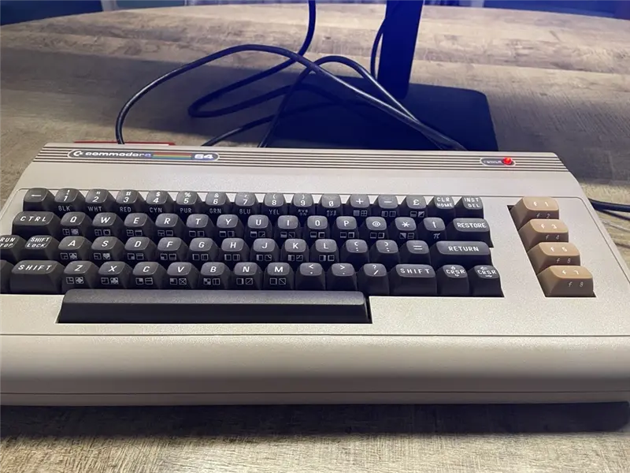
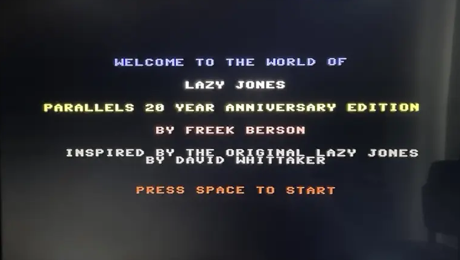
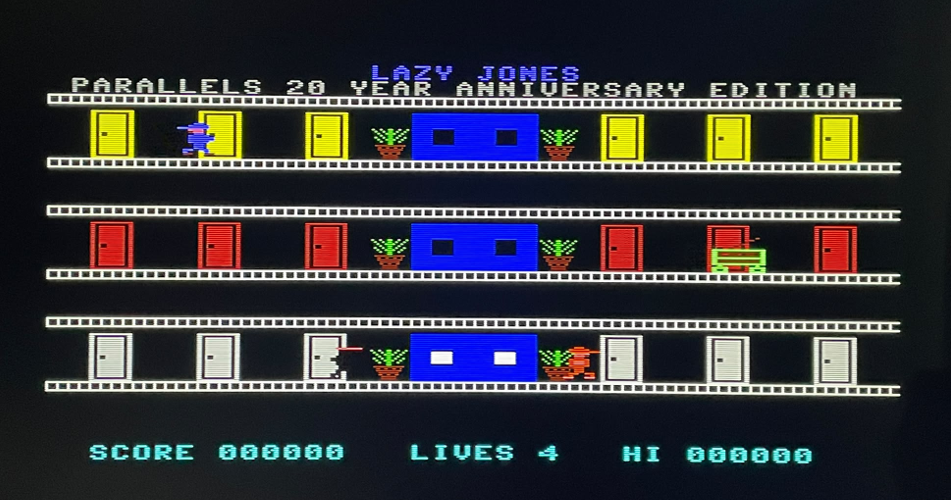
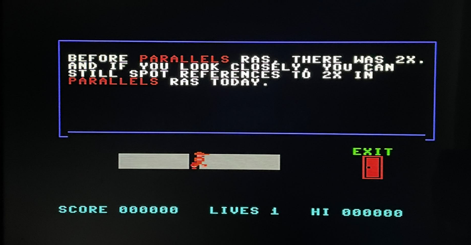
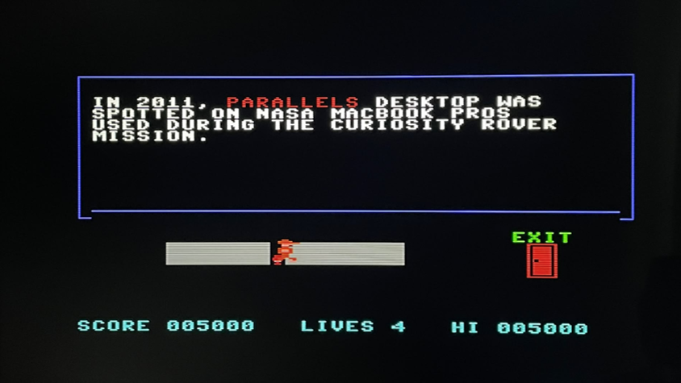

# Lazy Jones: Parallels 20-Year Anniversary Edition (C64)

<p align="left">
  <b>A fun retro tribute project built in 6502 assembly for Commodore 64.</b><br/>
  Created to celebrate <b>20 years of Parallels</b> and first showcased at the<br/>
  <b>Parallels VIPP Summit in Malta (Oct 2026)</b>.
</p>

---

<p align="center">
  
</p>

## 🕹️ What this project is

This is a C64-native tribute game inspired by the classic hotel format of *Lazy Jones*, reimagined for the Parallels 20-year anniversary.

> This is a personal project and fan tribute. It is not an official Parallels product and is not affiliated with, endorsed by, or representing Parallels as a company.

Instead of original mini-games, each room displays anniversary-themed content/messages, while preserving the classic arcade feel:

- floor-based movement
- central elevator travel
- roaming enemies
- lives + score HUD
- room entry + return loop

The project is intentionally simple, nostalgic, and demo/showcase-friendly.

---

## 🕹️ Why it was built

The goal was to create something memorable for the Parallels community that combines:

1. retro C64 aesthetics,
2. technical authenticity (real assembly + real C64 memory layout), and
3. a fun timeline/celebration concept.

This edition was first shown at the **Parallels VIPP Summit in Malta (Oct 2026)**, as part of the **20th anniversary** celebration.

### Personal retro background

The Commodore 64 was my first computer, bought for our family by my dad.
I started learning to write BASIC when I was 7 years old, and *Lazy Jones*
was one of the games I played from cassette tape.

That early C64 experience is a big reason this anniversary tribute exists.

---

## 🕹️ Screenshot gallery

> Visuals used in the showcase deck and project story.

<p align="center">
  
</p>

<p align="center">
  
</p>

<p align="center">
  
</p>

<p align="center">
  
</p>

---

## 🕹️ Repository contents (core share set)

If you only want to share the essential fun-project files on GitHub, these are the key artifacts:

- [`main.asm`](main.asm) — complete 6502 source (game logic + rendering + assets)
- [`run.ps1`](run.ps1) — convenience launcher (auto-build if needed, then runs in VICE)
- [Parallels RAS - Lazy Jones - 20 year edition.prg](Parallels%20RAS%20-%20Lazy%20Jones%20-%2020%20year%20edition.prg) — runnable C64 binary; also the filename used by the build and launch scripts

Additional helper scripts and setup tooling are included for convenience.

---

## 🕹️ Controls

| Key | Action |
|---|---|
| `A` / `D` | Move left / right |
| `W` | Move up / enter door / elevator up |
| `S` | Elevator down |
| `SPACE` | Start game / confirm / leave room |

### Joystick support

Joystick is supported for gameplay input (movement and fire), including standard emulator mappings and real C64 joystick setups.

---

## 🕹️ Build and run

### Requirements

- Windows PowerShell
- ACME cross-assembler
- VICE emulator (`x64sc`)

### Quick setup

From the project root folder:

```powershell
.\setup-acme.ps1
.\setup-vice.ps1
```

Scripts: [`setup-acme.ps1`](setup-acme.ps1), [`setup-vice.ps1`](setup-vice.ps1)

### Build

```powershell
.\build.ps1
```

Script: [`build.ps1`](build.ps1)

### Run

```powershell
.\run.ps1
```

[`run.ps1`](run.ps1) automatically builds first when needed (missing or outdated PRG), then launches VICE with autostart.

### Running on Commodore hardware

This project can run on real Commodore hardware, including:

- Commodore 64 / C64C systems
- Ultimate 64
- The newer Commodore 64 Ultimate platform from [commodore.net](https://commodore.net)

Typical flow:

1. Copy the PRG to your SD/USB media.
2. Load the PRG from your storage/browser interface.
3. Start it with `RUN`.

---

## 🕹️ Technical overview

### Rendering model

- Screen characters: `$0400` screen RAM
- Colors: `$d800` color RAM
- Border/background: `$d020` / `$d021`
- Custom charset: copied + stamped into RAM and selected via `$d018`

### Character and sprite approach

- Tile-based background for hotel floors, rails, doors, plants, elevator
- Hardware sprites for player + enemy actors
- Per-frame sprite pointer refresh to protect against screen clear side effects

### Input model

- Direct CIA keyboard matrix scanning (`$dc00/$dc01`)
- Game actions are deterministic and frame-synced

### Room flow

- Entering a door opens a room scene
- Message/fact content is displayed in monitor area
- Exiting returns player to hotel gameplay loop

### Sound

- Uses music from the original *Lazy Jones*, composed by **David Whittaker**, for an authentic retro experience. The music is not my own work; see the attribution and licensing notes below.

### Soundtrack history

#### From a C64 hotel room to dance floors and stadiums

**1984 — David Whittaker and “Star Dust.”** The original *Lazy Jones*,
released by Terminal Software, was created by **David Whittaker**, who handled
the programming, graphics and audio. Its music played through the C64's
three-voice SID sound chip. One particular tune, associated with the **Star
Dust** mini-game, would eventually reach an audience far beyond home computers.
It is that tune—not the entire *Lazy Jones* soundtrack—that connects the game
to a later dance hit.

**1999 — Zombie Nation's “Kernkraft 400.”** Around fifteen years later, German
electronic project **Zombie Nation** used the recognizable *Star Dust* melody
as the basis for **“Kernkraft 400,”** released in 1999. A little piece of C64
game music had found a second life as a club track.

**2000 — An international breakthrough.** The **DJ Gius remix**, by Cristiano
Giusberti (also known as **Technoboy**), helped turn the track into the version
many listeners recognize today. “Kernkraft 400” reached **number 2 on the UK
Singles Chart in September 2000**, bringing a melody familiar to C64 players
into the mainstream.

**Beyond the charts — A stadium anthem.** The track became a fixture at sporting
events, with crowds chanting along to its hook. Its use by teams such as the
**Boston Bruins** and at **Penn State football** games illustrates how far that
small home-computer melody travelled: from a mini-game inside a virtual hotel
to arenas full of people who may never have heard of *Lazy Jones*.

For me, that makes revisiting the game even more special. A tune I knew from
playing on cassette became something recognizable to a completely different
generation of listeners.

#### Sources and further reading

- [C64.COM: interview with David Whittaker](https://www.c64.com/interviews/whittaker.html) — his account of creating the original game's code, graphics and audio.
- [Lazy Jones: legacy and the Star Dust connection](https://en.wikipedia.org/wiki/Lazy_Jones#Legacy) — background on the melody's reuse.
- [Dancing Astronaut: twenty years of Kernkraft 400](https://dancingastronaut.com/2019/03/zombie-nation-released-beloved-inescapable-jock-jam-kernkraft-400-20-years-ago/) — its C64 roots and life as a stadium anthem.
- [Official Charts: UK Singles Chart, 24–30 September 2000](https://www.officialcharts.com/charts/singles-chart/20000924/7501/) — the single's number-two chart position.
- [Kernkraft 400: remix and sporting legacy](https://en.wikipedia.org/wiki/Kernkraft_400) — details on DJ Gius and its use at sporting events.

---

## 🕹️ Notes on assets and attribution

This is a fan tribute / anniversary demo project.

- The source/game implementation in this repository is original project code.
- **Music credit:** the original *Lazy Jones* music was composed by **David Whittaker**. I did not compose this music and do not claim ownership of it.
- The included [music/Lazy_Jones.sid](music/Lazy_Jones.sid) and the music embedded in the compiled PRG are third-party material. All rights to that music remain with the respective rights holders.
- **The music is not covered by this project's MIT License.** Its inclusion does not grant permission to copy, modify, or redistribute it.
- Attribution and a fan-project disclaimer do not replace permission or a suitable license. Before publicly distributing the SID or a PRG containing it, verify the redistribution rights or obtain permission from the relevant rights holders. If permission cannot be established, remove or replace the music and rebuild the PRG before publishing it.

---

## 🕹️ License

The original project code is licensed under the **MIT License**. Third-party music and other third-party material are excluded; their rights remain with their respective owners.

You can use, copy, modify, merge, publish, distribute, sublicense, and/or sell copies of the original project code, subject to the MIT terms. These permissions do not extend to the third-party music.

If you publish this on GitHub, add a [`LICENSE`](LICENSE) file with the MIT text at repository root.

---

## 🕹️ Credits

- Project concept and implementation: **Freek Berson**
- Anniversary context: **Parallels 20-year celebration**
- Showcase debut: **Parallels VIPP Summit, Malta (Oct 2026)**
- Inspired by classic C64-era hotel/arcade design language

---

## 🕹️ Future ideas

- Alternate room content packs
- Optional title-card variants for events
- Additional enemy patterns and difficulty ramp
- Optional joystick remap presets
