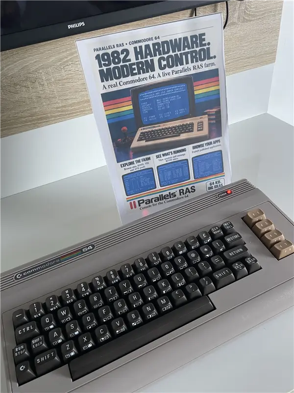
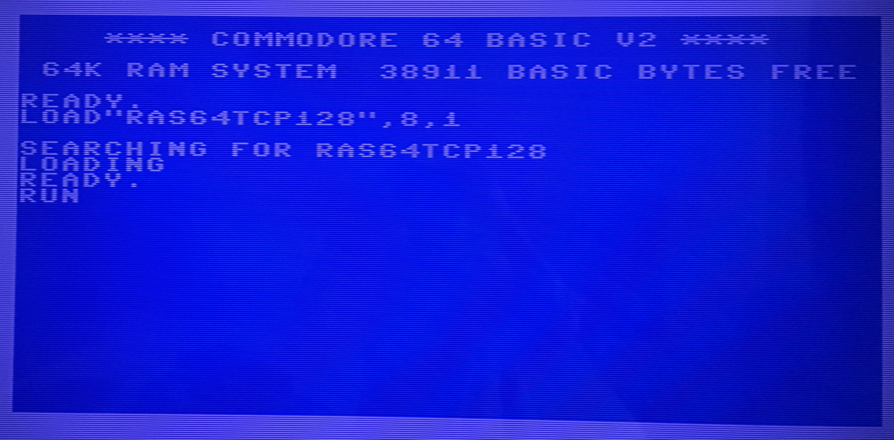
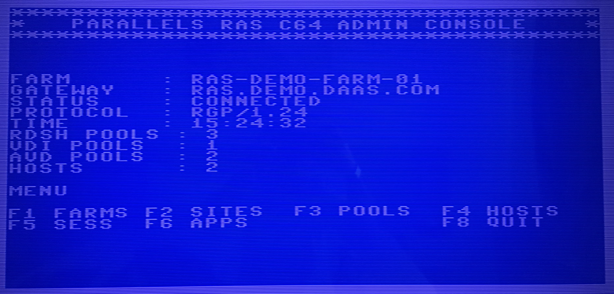
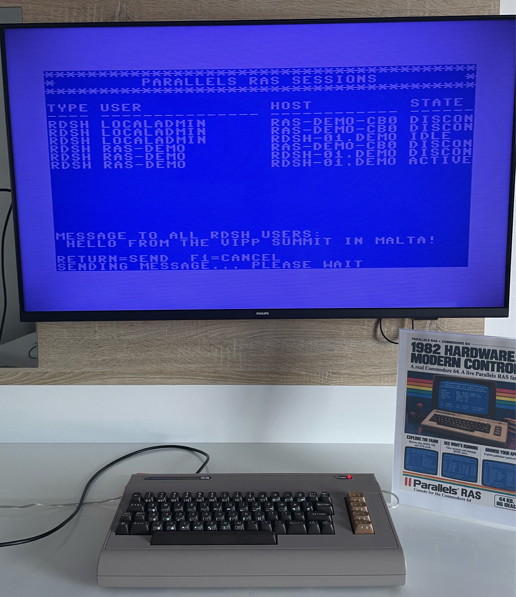
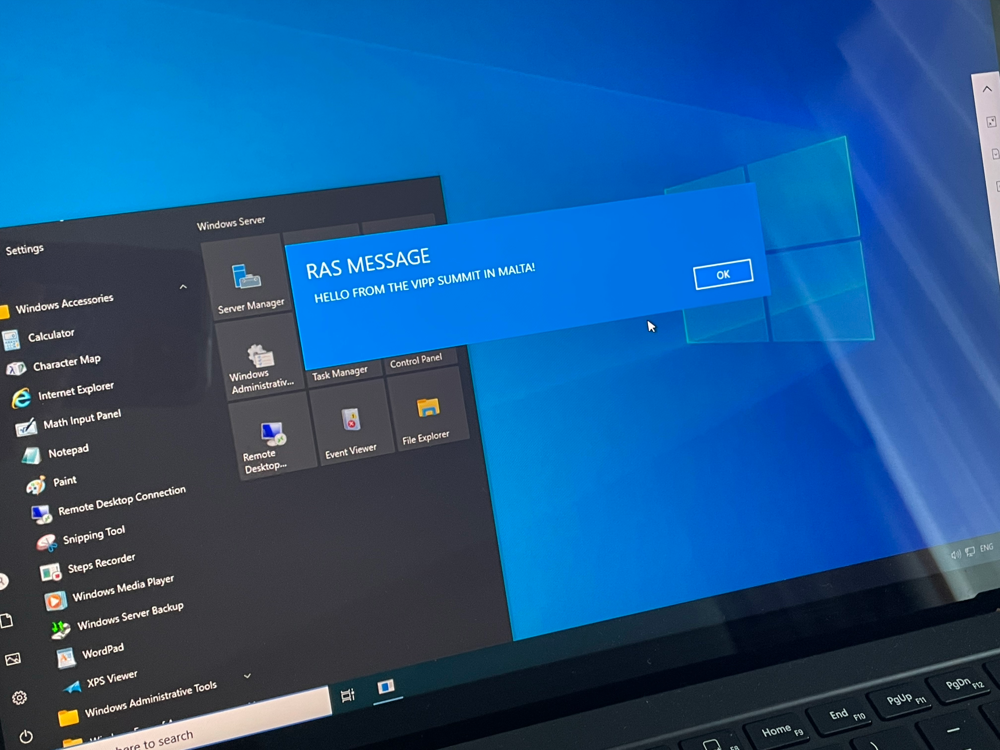

# Parallels RAS C64 Admin Console (v1.29)

A retro administration console project that lets a Commodore 64 Ultimate connect and view a live Parallels RAS environment data.

> This is a personal hobby project, created in my own time. It is not an official Parallels product and is not affiliated with or endorsed by Parallels.

This project was first showcased at the VIPP Summit 2026 in Malta.

## 🕹️ About the Commodore 64 Ultimate

This project is designed to run on modern Commodore 64 Ultimate hardware as well as compatible retro setups.

The C64 Ultimate keeps the classic Commodore feel while adding modern conveniences such as:

- HDMI video output
- built-in Wi-Fi
- USB connectivity
- modern storage and file handling support
- compatibility with original-style peripherals and software

That combination makes it a good fit for a project like Retro Gateway: authentic BASIC-era interaction on the front end, with contemporary connectivity and display options underneath.

Learn more here:

- [Commodore 64 Ultimate](https://commodore.net/computer/)

## 🕹️ VIPP Summit 2026 summary

At the VIPP Summit 2026 in Malta, this project was shown as a live retro demo that connected a classic Commodore 64 to modern Parallels RAS operations.

The event highlighted:

- direct community feedback from EUC experts
- roadmap and next-step discussions
- celebration of 10 years of the VIPP program
- celebration of 20 years of Parallels
- the C64 + RAS showcase as a fun technical proof point

Read the summit post/article here:

- [VIPP Summit 2026 LinkedIn post](https://www.linkedin.com/feed/update/urn:li:activity:7516369268524105728/)

## 🕹️ What this project is

Retro Gateway combines classic C64 presentation with modern infrastructure data:

- C64 client for keyboard + screen experience
- PowerShell gateway for protocol, auth, and data retrieval
- Parallels RAS cmdlets as the live data source

The result is a "full C64 vibe" frontend with modern backend logic.

## 🕹️ Why BASIC on the C64, and why PowerShell for the backend

The C64 app is written in BASIC (with embedded machine code for crypto) to preserve the authentic retro development feel and user experience.

Over time, more logic moved to the PowerShell service because:

- complex business logic is easier to maintain server-side
- RAS querying belongs close to the RAS cmdlets
- rendering decisions can be centralized
- multiple C64 consoles can connect to the same gateway endpoint, each authenticating independently

In short: C64 for experience, PS1 for scale and maintainability.

## 🕹️ How it works

1. C64 dials the gateway host on TCP/6464.
2. Gateway and client perform challenge/response authentication.
3. C64 sends a command (menu key mapping).
4. Gateway queries RAS cmdlets.
5. Gateway renders a full 40x25 payload and sends it back.
6. C64 writes payload to screen RAM and waits for next key.

## 🕹️ How it looks in action

### Step 1 - Connect and authenticate

### Step 2 - Main dashboard
Here you see the various menu options like showing farms, sites, host pools, host, sessions and apps.

### Step 3 - Active user sessions
Here we see the active sessions of an RDSH host pool, with host they run on and the current state of the session. There also is the ability to send messages to users.

### Step 4 - RAS user session receiving a message
Here we see a user session that receives a message from the C64 RAS Admin console.

## 🕹️ Repository contents (this folder)

- [RAS64TCP129.BAS](RAS64TCP129.BAS) - BASIC source for the C64 client
- [RAS64TCP129.PRG](RAS64TCP129.PRG) - compiled C64 program
- [RetroGateway-RawTcp-v129.ps1](RetroGateway-RawTcp-v129.ps1) - PowerShell gateway service
- [README-v129.md](README-v129.md) - technical/authentication release notes
- [RetroGateway_Design_Specification.md](RetroGateway_Design_Specification.md) - design details
- [RetroGateway_Project_Documentation.md](RetroGateway_Project_Documentation.md) - broader project docs

## 🕹️ Sanitized demo values in this publish set

Sensitive/lab-specific values were replaced with placeholders before publishing.

| Setting | File | Demo value | Replace with |
|---|---|---|---|
| Gateway host (C64 dial target) | [RAS64TCP129.BAS](RAS64TCP129.BAS) | `RAS-GATEWAY.EXAMPLE.NET` | Your public DNS/IP endpoint |
| Pre-shared auth key (`KY$`) | [RAS64TCP129.BAS](RAS64TCP129.BAS) | `0123456789ABCDEF0123456789ABCDEF` | New random 32-char uppercase hex key |
| RAS server | [RetroGateway-RawTcp-v129.ps1](RetroGateway-RawTcp-v129.ps1) | `ras-gateway01.example.local` | Your RAS Publishing Agent/CB |
| RAS username | [RetroGateway-RawTcp-v129.ps1](RetroGateway-RawTcp-v129.ps1) | `c64operator@example.local` | Service/admin account |
| Gateway DNS display value | [RetroGateway-RawTcp-v129.ps1](RetroGateway-RawTcp-v129.ps1) | `ras-gateway.example.net` | Your public gateway DNS |
| Pre-shared auth key (`$AuthenticationKey`) | [RetroGateway-RawTcp-v129.ps1](RetroGateway-RawTcp-v129.ps1) | `0123456789ABCDEF0123456789ABCDEF` | Same key as `KY$` |

### Replace values safely

1. Edit placeholders in both BAS and PS1.
2. Keep `KY$` and `$AuthenticationKey` exactly identical.
3. Use a fresh random 32-character uppercase hexadecimal key.
4. Rebuild/export the PRG from updated BASIC source.
5. Deploy updated BAS/PRG and PS1 together.

## 🕹️ Hosting the PowerShell gateway

Recommended Windows host setup:

1. Install PowerShell 7+ and the required RAS module.
2. Place [RetroGateway-RawTcp-v129.ps1](RetroGateway-RawTcp-v129.ps1) on the host.
3. Update placeholders (`$RasServer`, `$RasUsername`, `$GatewayDns`, `$AuthenticationKey`).
4. Open inbound TCP port `6464` only from trusted source IPs.
5. Run script interactively first to validate connectivity and rendering.
6. For persistent hosting, run as a Scheduled Task at startup under a least-privilege service account.
7. Monitor logs/console output and rotate the key periodically.

## 🕹️ Security notice

This implementation uses raw TCP and is intended for demo/lab use only.

- traffic is not end-to-end encrypted
- do not expose to untrusted networks
- do not treat this as production-ready remote administration

Use firewall/IP restrictions and isolated environments.

## 🕹️ License and rights

No rights are granted beyond the project license. See:

- [LICENSE.mcs](https://github.com/fberson/Commodore64/blob/main/LICENSE.mcs)

## 🕹️ Future improvements

- end-to-end encryption (TLS or equivalent)
- stronger mutual authentication
- further 6502 assembly porting for faster C64-side execution
- expanded RAS operational capabilities (more actions/screens)
- richer multi-console concurrency and session coordination

## 🕹️ Personal project statement

This is a personal retro/homelab-style hobby project, built independently in personal time for learning and demonstration.